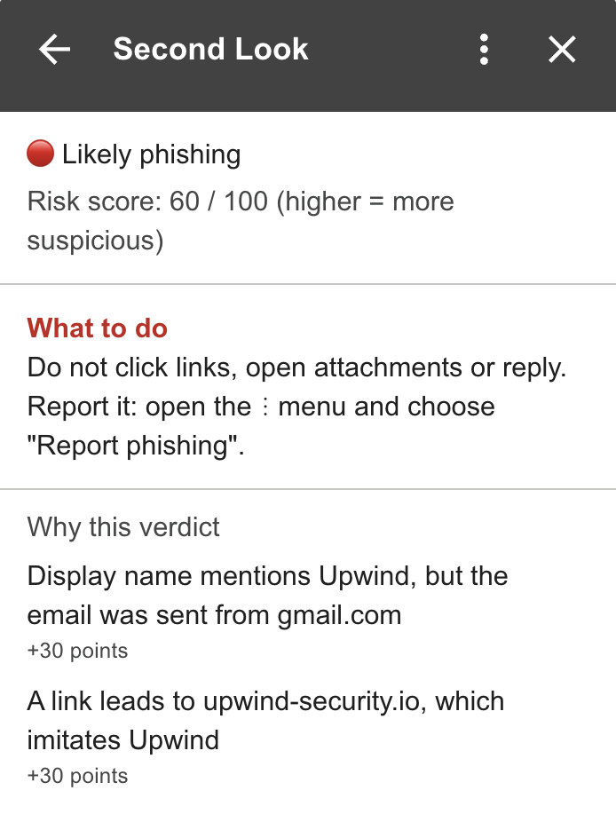
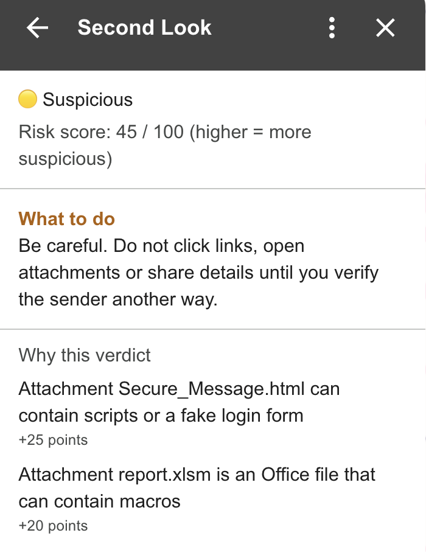
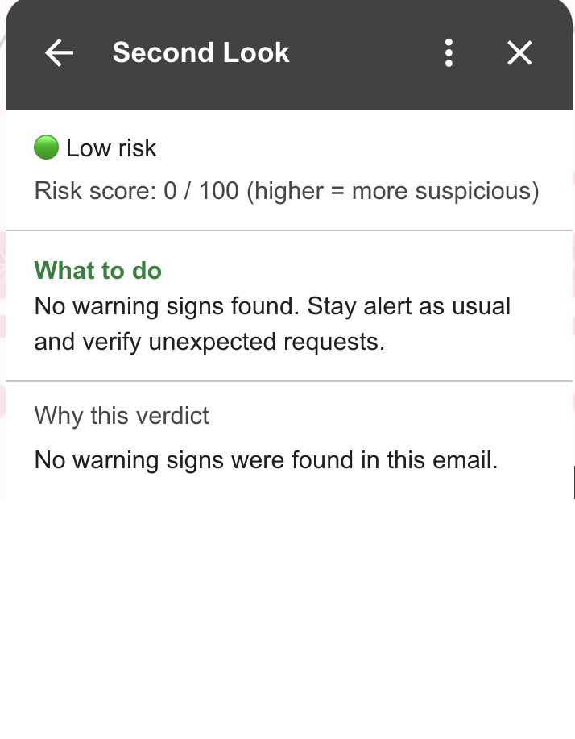
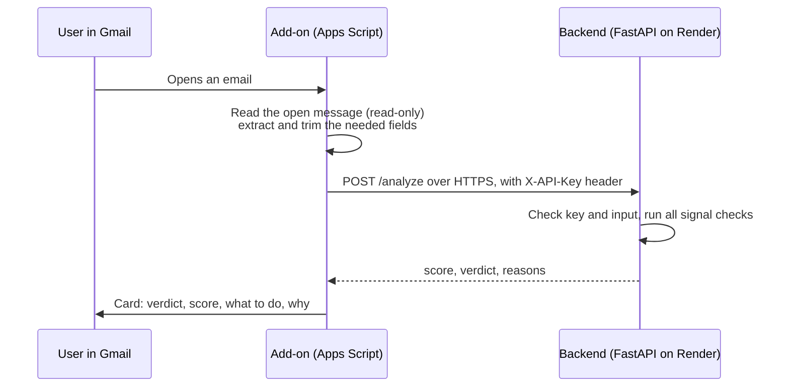

# Second Look

**A Gmail add-on that takes a second look at the email you just opened, and tells you whether it looks like phishing, how risky it is, and why.**

When you open an email, Second Look shows a card next to it with:

- a **verdict** (🟢 Low risk, 🟡 Suspicious, 🔴 Likely phishing),
- a **risk score** from 0 to 100 (higher means more suspicious),
- **what to do** next, in plain language,
- **the reasons** behind the verdict, each with the points it added.

<p align="center">
  
  
  
</p>

---

## Table of contents

1. [Product decisions](#product-decisions)
2. [Architecture](#architecture)
3. [Detection signals](#detection-signals)
4. [Scoring and verdicts](#scoring-and-verdicts)
5. [Security](#security)
6. [Privacy](#privacy)
7. [Testing](#testing)
8. [Setup and running](#setup-and-running)
9. [Trade-offs](#trade-offs)
10. [Limitations](#limitations)
11. [What I would do with more time](#what-i-would-do-with-more-time)

---

## Product decisions

**Who it is for.** The add-on is tailored to the people Upwind serves: cloud, DevOps and security teams. Attackers target them for cloud-console credentials, code-hosting tokens and SSO access, so the detection knows the platforms they rely on (AWS, Azure, Google Cloud, GitHub, Okta, Slack, Atlassian, DocuSign) and recognizes impersonation of Upwind itself.

**Hebrew and English.** Most phishing detectors only understand English. Israeli users receive phishing that impersonates local brands (Israel Post, Bank Leumi, Bank Hapoalim, Isracard, National Insurance) in Hebrew, so brand names and pressure phrases are covered in both languages.

**Explainable, not a black box.** Every point in the score comes from a named signal with a human-readable reason. The user sees exactly why an email was flagged and can judge for themselves.

**A second opinion, not a guarantee.** Gmail already filters out the phishing it is sure about (and does not run add-ons on spam). Second Look focuses on what made it to the inbox. The card says so explicitly, so users do not over-trust it.

**Few false alarms on marketing emails.** Real marketing emails also use urgent language, like "Last chance!!". I know this well from my experience testing CRM campaigns. So pressure signals on their own can never make an email "Suspicious". They only add weight to stronger signals.

**Tell the user what to do.** A verdict alone is not enough, so each verdict comes with a concrete recommendation (for example, how to report phishing in Gmail).

---

## Architecture



The solution has two parts with a clear split of responsibilities:

- **The add-on** (`addon/`, Google Apps Script) is a **thin client**. It reads the currently open email, sends only the fields the analysis needs, and renders the result as a Gmail card. It contains no detection logic.
- **The backend** (`backend/`, Python + FastAPI, hosted on Render) holds all detection logic. It authenticates the add-on, validates the input, runs the signal checks and returns an explainable result. It stores nothing.

**Why this split.** The add-on is the *client*: it is the part the user sees, and it sends requests to the backend. The backend is the *server*: it receives those requests and answers them. Keeping all detection logic on the server means that:

- it is easier to write and test in Python than in Apps Script,
- it can be improved and redeployed without touching the add-on,
- future secrets (such as keys for external services) stay on the server, not in the add-on's code.

### Repository structure

**Add-on (`addon/`)**

| File | What it does |
|---|---|
| **`appsscript.json`** | Add-on manifest: permissions, URL allowlist, Gmail trigger |
| **`Code.gs`** | Reads the open email, calls the backend, builds the card |

**Backend (`backend/`)**

| File | What it does |
|---|---|
| **`main.py`** | API: authentication, request size limit, routes |
| **`models.py`** | Request and response formats, with size limits |
| **`scoring.py`** | Engine: runs all checks, adds up the points, picks the verdict |
| **`brands.py`** | Impersonated brands, their real domains, free mail providers |
| **`domains.py`** | Helpers for parsing addresses and comparing domains |
| **`text.py`** | Text cleanup before matching: removes invisible characters and normalizes character variants |
| **`signals/auth.py`** | SPF, DKIM and DMARC results |
| **`signals/sender.py`** | Display name, look-alike domains, Reply-To, malformed sender |
| **`signals/links.py`** | Deceptive, hidden, IP, shortened and look-alike links |
| **`signals/pressure.py`** | Urgency wording (English and Hebrew) and alarming formatting |
| **`signals/attachments.py`** | Risky file types and disguised file names |
| **`tests/test_scoring.py`** | Scenario tests for the engine |
| **`tests/test_api.py`** | Authentication and input-validation tests |
| **`requirements.txt`** | Libraries the server needs (exact versions) |
| **`requirements-dev.txt`** | Extra libraries for running the tests |
| **`pytest.ini`** | Test configuration |

---

## Detection signals

Each signal adds points and a reason. Each kind of signal is counted once per email, even if it appears several times.

### Sender and authentication

| Signal | Points | What it catches |
|---|---|---|
| DMARC failure | 30 | The sender's domain does not vouch for the email, so the address may be forged |
| SPF failure | 15 | The email came from a server not authorized to send for the domain |
| DKIM failure | 15 | The digital signature is invalid (one passing signature is enough to clear it) |
| Brand in display name | 30 | The name says "PayPal" or "Upwind Security", but the address is not from that brand |
| Look-alike sender domain | 35 | `paypa1.com`, `amazom.com`, `leumi-update.net`, `paypal.com.evil.net` |
| Brand name as a subdomain | 20 | `paypal.secure-login.com`, where the real owner is `secure-login.com` |
| Encoded (punycode) domain | 20 | Domains that can hide look-alike letters from other alphabets |
| Reply-To to another organization | 15 | Replies would go somewhere other than the sender's organization |
| Malformed sender | 20 | Missing or broken sender address |

Authentication results are read only from the header written by Gmail itself (`mx.google.com`). Any other `Authentication-Results` header is ignored, because a sender can forge one.

### Links

| Signal | Points | What it catches |
|---|---|---|
| Deceptive link | 30 | The visible text shows one address, the link goes to another |
| Hidden destination (`@` trick) | 25 | `https://paypal.com@evil.net`, which actually opens `evil.net` |
| Look-alike link | 30 | Links to sites imitating a brand, such as a fake AWS console login page |
| Brand name in a link's subdomain | 20 | `https://paypal.secure-login.com/verify` |
| Raw IP address | 20 | Links to numbers instead of a named website |
| URL shortener | 10 | `bit.ly` and similar services that hide the destination |

Links are only parsed as text. **They are never opened.**

A brand name used as a subdomain is a weaker signal (20 points) than a look-alike domain, because companies also host their own tools at addresses like `jira.company.com`. On its own it stays Low risk; together with other signals it raises the verdict.

### Pressure

| Signal | Points | What it catches |
|---|---|---|
| Pressure wording | 5 per phrase, up to 15 | "urgent", "account will be suspended", "MFA reset", "API key exposed", "דחוף", "החשבון שלך ייחסם" |
| Alarming formatting | 5 each, up to 10 | Repeated `!!`, several ALL-CAPS words in the subject, warning symbols such as ⚠️ |

Pressure signals together are capped at **20 points**, below the "Suspicious" threshold.

### Attachments

| Signal | Points | What it catches |
|---|---|---|
| Right-to-left override in file name | 40 | An invisible character that makes `invoice[RLO]fdp.exe` display as `invoiceexe.pdf` |
| Double extension | 40 | `invoice.pdf.exe` |
| Executable or script | 35 | `.exe`, `.js`, `.ps1`, `.lnk`, `.iso` and similar |
| Web content | 25 | `.html` and `.svg` files that can carry scripts or fake login forms |
| Macro-enabled Office file | 20 | `.docm`, `.xlsm` and similar |
| Unusually many attachments | 15 | More than 20 attachments (only the first 20 are inspected) |

Only file names and metadata are inspected. File contents never leave Google.

---

## Scoring and verdicts

The score is the sum of the points of all signals found, capped at 100.

| Score | Verdict |
|---|---|
| 0 to 24 | 🟢 Low risk |
| 25 to 59 | 🟡 Suspicious |
| 60 to 100 | 🔴 Likely phishing |

**How the thresholds were chosen.** Strong signals (authentication failure, impersonation, deceptive links, dangerous files) are worth 30 points or more, so **any single strong signal makes an email Suspicious**, and **two independent strong signals make it Likely phishing**. Weak signals (pressure, Reply-To, shorteners) need to accumulate. Legitimate email very rarely triggers even one strong signal.

The verdict is worded "Likely phishing" rather than "Phishing", and the lowest level is "Low risk" rather than "Safe": no tool can guarantee an email is safe.

---

## Security

Emails, attachments and external responses are all treated as untrusted input.

**Secrets**
- The API key lives only in Render's environment variables and in the add-on's Script Properties. It never appears in the code or in the repository.
- Development and tests use separate, non-secret keys, so the real key exists in as few places as possible.
- Rotating the key takes a minute and needs no code change.

**Authentication**
- Every analysis request must carry the API key in the `X-API-Key` header.
- The key is compared in constant time, to prevent timing attacks.
- The server **fails closed**: if no key is configured, every request is rejected.
- Error messages are generic and reveal nothing about why a check failed.

**Least privilege**
- The add-on can only read the **currently open** message, read-only. It cannot read the rest of the inbox, send or delete.
- The manifest's URL allowlist lets the add-on send requests **only to the backend**, so a bug or a malicious email cannot make it send data elsewhere.
- Render has access to this repository only.

**Untrusted input**

Size is controlled in three layers, so that every real email gets analyzed while oversized input can never overload the server:

| Layer | Where | What it checks | Result |
|---|---|---|---|
| 1. Trimming | Add-on (`truncate` in `Code.gs`) | Each field separately | Trims it to the limit, so real emails always pass |
| 2. Request size | Backend (`main.py`) | The whole request (over 1 MB) | Rejected before it is read (413) |
| 3. Schema | Backend (`models.py`) | Each field separately | Rejected if too long (422) |

Layers 2 and 3 protect the server even from requests that do not come from the add-on.

- Invisible characters are removed and special character variants are normalized before matching, so an attacker cannot hide "PayPal" or "urgent" by inserting a zero-width character.
- Every signal check runs in isolation: a malformed email that breaks one check does not stop the others.
- HTML is parsed as text only. Nothing is rendered, executed or loaded, and links are never opened.
- `Authentication-Results` is trusted only when written by Gmail.
- Unusual input (a malformed sender, many attachments) is treated as a signal, not as an error, so attackers cannot avoid a warning by breaking the parser.

**Untrusted output**
- Everything shown in the card that comes from the email or from the backend is HTML-escaped.
- The add-on accepts only known verdict values and clamps the score to 0 to 100.
- Failures show a generic message to the user; technical details go only to the log.

**Threat review**
- I reviewed the system from an attacker's point of view. I found no realistic way to steal data or take control: no email data is stored, the key is strong and kept out of the code, and the add-on can read only the open message and send only to the backend.
- I did find ways to evade detection. The most common ones (a brand name used as a subdomain, and invisible characters inside words) are now detected and covered by tests. The rest are listed under [Limitations](#limitations).

**Hardening**
- Interactive API documentation (`/docs`, `/openapi.json`) is disabled in production, so the API is not publicly described.
- Runtime dependencies are pinned to exact versions; test dependencies are kept separate and are not installed on the server.

---

## Privacy

To detect deceptive links and pressure wording, the add-on sends the email body to the backend. To keep that safe:

- It travels only over **HTTPS**, and only to **this backend** (enforced by the URL allowlist).
- The backend analyzes it in memory and **does not store it** anywhere: there is no database and no file storage.
- **Logs never contain email content**, only error types and status codes.
- **Attachment contents never leave Google.** Only file names, types and sizes are sent.

---

## Testing

The backend has **48 automated tests** (pytest):

- **`test_scoring.py`**: 39 end-to-end scenarios, each an email with the expected score, verdict **and** the exact set of signals that should fire. They cover every signal, and just as importantly, emails that must **not** be flagged: the real PayPal, a legitimate subdomain, a forged authentication header, a marketing email, a person named "Dawson" (who should not match "aws"), National Insurance vs. Bank Leumi, and more.
- **`test_api.py`**: the security layer: missing key, wrong key, correct key, fail-closed when no key is configured, oversized fields (422), oversized requests (413), and docs disabled by default.

To run the tests yourself:

```bash
cd backend
pip install -r requirements-dev.txt
python -m pytest -v
```

The add-on was tested manually in Gmail with real emails covering deceptive links, a fake AWS console page, risky attachments, impersonation of Upwind, and a real Hebrew marketing email (correctly rated Low risk).

---

## Setup and running

These steps set up **your own copy** of Second Look. Each backend accepts only requests that carry its own API key, so your copy needs its own backend and its own key.

### Requirements

- Python 3.10 or later
- A Google account with Gmail
- A place to host the backend over HTTPS (this project uses [Render](https://render.com), free plan)

### 1. Generate an API key

```bash
python3 -c "import secrets; print(secrets.token_urlsafe(32))"
```

Keep it private. You will use it in steps 2 and 3.

### 2. Deploy the backend

On Render: **New → Web Service**, connect your copy of this repository, then:

| Setting | Value |
|---|---|
| Root directory | `backend` |
| Build command | `pip install -r requirements.txt` |
| Start command | `uvicorn main:app --host 0.0.0.0 --port $PORT` |
| Environment variable | `API_KEY` = the key from step 1 |

Check that `https://<your-service>.onrender.com/health` returns `{"status":"ok"}`.

**Environment variables**

| Variable | Required | Purpose |
|---|---|---|
| `API_KEY` | Yes | Key the add-on must send. If missing, every request is rejected |
| `ENABLE_DOCS` | No | Set to `true` to enable `/docs` (for local development only) |

### 3. Install the add-on

1. Go to [script.google.com](https://script.google.com) and create a new project.
2. In **Project Settings**, enable **Show "appsscript.json" manifest file in editor**.
3. Replace the contents of `appsscript.json` and `Code.gs` with the files from `addon/`.
4. In `appsscript.json`, set `urlFetchWhitelist` to your backend URL, ending with `/`.
5. In **Project Settings → Script Properties**, add:
   - `BACKEND_URL`: your backend URL, without a trailing `/`
   - `API_KEY`: the key from step 1
6. **Deploy → Test deployments → Install** (Application: Gmail).
7. Open Gmail, open an email, and click the Second Look icon in the side panel. Approve the requested permissions the first time.

### Running the backend locally

```bash
cd backend
pip install -r requirements-dev.txt
export API_KEY=local-test-key
ENABLE_DOCS=true uvicorn main:app --reload --port 8000
```

Interactive docs are then available at `http://localhost:8000/docs`.

---

## Trade-offs

| Decision | Why | Cost |
|---|---|---|
| Apps Script for the add-on | Google's native way to build Gmail add-ons; handles OAuth and Gmail access | Code must be copied manually between Apps Script and the repository |
| Thin client, logic in the backend | Testable, updatable without reinstalling, keeps future secrets server-side | Email data has to leave Gmail (see [Privacy](#privacy)) |
| Rule-based signals instead of ML or an LLM | Deterministic, explainable, no training data needed, no email content sent to third parties, no prompt-injection risk | Weights are expert judgment, not learned from data |
| Pre-shared API key | Simplest secure option between two systems I control | One shared secret; no per-user identity |
| Render free plan | Free HTTPS hosting with automatic deploys from GitHub | The server sleeps after inactivity; the first request can take up to a minute |
| No external reputation services | Privacy and simplicity within the time frame | Known-malicious links are only caught if they also match a signal |

---

## Limitations

- **Weights are expert judgment.** They were not calibrated on a labeled dataset, so precision and recall are not measured.
- **Attachments are checked by name only.** A malicious file with an innocent name (for example `report.pdf`) is not detected; that requires content scanning by an antivirus engine.
- **Static lists.** Brands and pressure phrases are hand-maintained. A brand or wording not on the list is not detected.
- **Languages.** Pressure detection covers English and Hebrew only.
- **Look-alike letters from other alphabets** (for example a Cyrillic "а" in "PаyPal") are caught in sender domains through the punycode check, but not in display names or link text.
- **Assumptions.** The add-on assumes the `Authentication-Results` header it reads is the one Gmail adds at the top of the message. Only the libraries installed directly are pinned to exact versions, not the libraries they depend on.
- **Not covered:** phishing text inside images, QR-code phishing, and emails sent from a legitimate account that was compromised (these pass all authentication checks).
- **Forwarded mail and mailing lists** can fail SPF or DMARC legitimately and may be rated Suspicious.
- **Truncation.** Content beyond the size limits (for example the 21st attachment or text beyond 50,000 characters) is not inspected; an unusually high attachment count is flagged instead.
- **Request-size check** relies on the declared `Content-Length`; requests without it are bounded only by the schema limits.
- **No rate limiting** on the backend.
- **The URL allowlist** protects against bugs and malicious email content, not against someone with edit access to the Apps Script project (that is protected by Google account security).
- **Card alignment** follows the user's Gmail language; in a right-to-left interface the English text is right-aligned.
- **The add-on code** is tested manually, not automatically.

---

## What I would do with more time

1. **Calibrate the scoring** on a labeled dataset of phishing and legitimate emails, measure precision and recall, and tune the weights and thresholds from the results.
2. **Link reputation** with Google Safe Browsing or VirusTotal, with the API key kept on the backend and the responses treated as untrusted input.
3. **Domain age**: newly registered domains are a strong phishing signal.
4. **Per-user authentication**: send a Google-signed identity token instead of a shared key, enabling per-user rate limits and revocation.
5. **Rate limiting** on the backend.
6. **Sender history** ("first time this sender has written to you"), as an opt-in feature, since it requires broader Gmail access.
7. **QR-code and image analysis** for phishing that hides its content in images.
8. **Cross-alphabet look-alike detection**: map look-alike characters from other alphabets to Latin letters before matching brand names.
9. **Fully locked dependencies**, including the libraries our libraries depend on, with hash checking.
